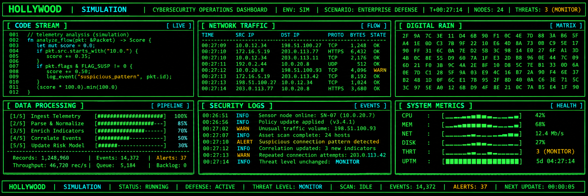

# Hollywood CLI

Hollywood CLI turns an interactive terminal into a fictional, animated operations dashboard inspired by the multi-pane Linux `hollywood` experience. It is built with .NET and runs its panels in one terminal canvas.

**Safety:** Hollywood displays synthetic activity. It does not scan networks, send packets, access credentials, execute displayed code, or monitor other applications. System readings shown in the dashboard are simulated.

## Availability

This repository is a development preview. **There are no official downloadable installers or release archives yet.** Until packages appear on the [Releases page](https://github.com/krishna28004/Hollywood-CLI/releases), use the source instructions below. Don’t treat local build artifacts as official releases.



| Platform | Current status |
| --- | --- |
| Windows x64 | Local Windows 10 x64 build, ConPTY, per-user installer lifecycle, PowerShell/CMD lookup, and Git Bash command lookup exercised. Direct Windows Terminal and classic Console Host coverage remains pending. |
| Windows ARM64 | CI build and ConPTY job passed; validation in a normal user terminal on ARM64 remains pending. |
| Linux x64/ARM64 | CI build, snapshot, and publish steps passed; PTY checks exposed stale screen-title and exit-key expectations. Both are corrected in the current source and need a green CI rerun. |
| macOS Intel/Apple Silicon | CI build, snapshot, and publish steps passed; PTY checks exposed stale screen-title and exit-key expectations. Both are corrected in the current source and need a green CI rerun. |

Compatibility depends on both the operating system and the terminal emulator. Windows Terminal, classic Console Host, and Linux/macOS terminal emulator coverage will be expanded before those combinations are called fully supported.

## Try Hollywood from source (developer preview)

There is not yet a one-click public installer. Running from source requires Git and the **.NET 10 SDK**. Get the SDK from [Microsoft’s .NET download page](https://dotnet.microsoft.com/download/dotnet/10.0). These commands build/run the app from its checkout; they do not install a global `hollywood` command. If you only want to run the app, wait for an official release package on the [Releases page](https://github.com/krishna28004/Hollywood-CLI/releases).

### Windows PowerShell or Windows Terminal

Open PowerShell and run:

```powershell
git clone https://github.com/krishna28004/Hollywood-CLI.git
Set-Location Hollywood-CLI
dotnet run --project src/Hollywood.Cli
```

In a new PowerShell window, repeat the final command from the cloned folder to start Hollywood again.

### Windows Git Bash

Open Git Bash and run:

```bash
git clone https://github.com/krishna28004/Hollywood-CLI.git
cd Hollywood-CLI
winpty dotnet run --project src/Hollywood.Cli
```

Git Bash’s mintty terminal needs `winpty` for interactive Windows console programs. When an official Windows installer is released, its launcher is intended to make the command available as `hollywood` in a new terminal.

### Linux or macOS

In an interactive terminal, run:

```bash
git clone https://github.com/krishna28004/Hollywood-CLI.git
cd Hollywood-CLI
dotnet run --project src/Hollywood.Cli
```

Native Linux and macOS runtime behavior has not been verified yet. These are developer-preview instructions, not a claim that every distribution or terminal is supported.

## Controls

| Key | Action |
| --- | --- |
| `Q` or `Esc` | Exit |
| `Ctrl+C` | Cancel and restore the terminal |
| `Space` | Pause or resume |
| `T` | Cycle themes |
| `L` | Cycle layouts |
| Other keys | Increase simulated activity while pressed; key contents are not stored |

When typing stops, animation gradually returns to a quieter idle state. Use `--keyboard-reactive off` to disable this behavior.

## Themes and options

Hollywood includes Classic, Cyberpunk, SOC, Matrix, and Retro themes. Common options:

```text
--theme classic|cyberpunk|soc|matrix|retro
--layout auto|focus|dense
--panels 2|3|6|7|10
--speed slow|normal|fast
--fps 1..60
--keyboard-reactive on|off
--reduced-motion
--seed NUMBER
--snapshot
```

Examples:

```powershell
dotnet run --project src/Hollywood.Cli -- --theme matrix --speed fast
dotnet run --project src/Hollywood.Cli -- --layout dense --keyboard-reactive off
dotnet run --project src/Hollywood.Cli -- --snapshot --theme retro --seed 12345
```

`--snapshot` writes plain text and does not start the interactive display. For the complete option list, run:

```powershell
dotnet run --project src/Hollywood.Cli -- --help
```

## Configuration

Configuration is optional and is never created or overwritten automatically.

- **Windows:** `%LOCALAPPDATA%\Hollywood\config.json`
- **Linux:** `$XDG_CONFIG_HOME/hollywood/config.json`, or `~/.config/hollywood/config.json`
- **macOS:** `~/Library/Application Support/Hollywood/config.json`

Inspect or validate configuration with:

```text
dotnet run --project src/Hollywood.Cli -- config path
dotnet run --project src/Hollywood.Cli -- config show
dotnet run --project src/Hollywood.Cli -- config validate
```

See [`examples/config.json`](examples/config.json) for themes, layout, speed, enabled modules, reduced motion, and keyboard-reactivity settings.

## Build and verify

```powershell
dotnet build Hollywood.sln -c Release
dotnet tests/Hollywood.UnitTests/bin/Release/net10.0/Hollywood.UnitTests.dll
```

The Windows ConPTY interaction harness can be run against a built Windows executable:

```powershell
dotnet tests/Hollywood.ConPty/bin/Release/net10.0/Hollywood.ConPty.dll path\to\hollywood.exe
```

This harness is Windows-only. Unit or ConPTY success does not establish compatibility with every terminal emulator. See [`docs/implementation`](docs/implementation/) for current evidence and pending checks.

## Downloadable releases

There are currently **no downloadable release assets** on the [GitHub Releases page](https://github.com/krishna28004/Hollywood-CLI/releases). CI packages are build artifacts, not published releases, and may expire. Once qualified, the intended Windows flow is to download the matching x64 or ARM64 setup, install it per-user, open a new terminal, and type `hollywood`. Linux and macOS archives and package-manager instructions will be added only after their PTY checks pass and platform limitations are documented.

## License

No project license has been declared yet. The public repository is available to view, but no general permission to reuse, modify, or redistribute the project is granted. A license must be added before third parties are told they can use or redistribute Hollywood. See [GitHub’s licensing guidance](https://docs.github.com/en/repositories/managing-your-repositorys-settings-and-features/customizing-your-repository/licensing-a-repository).
